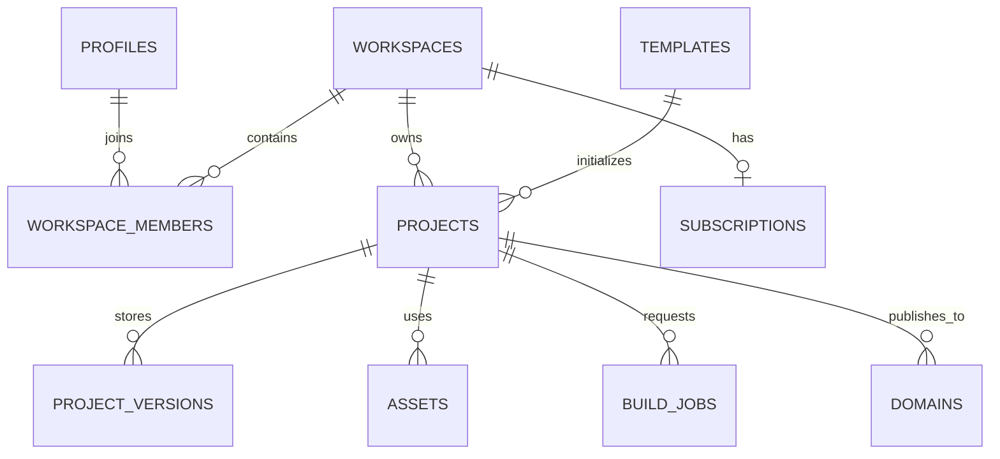
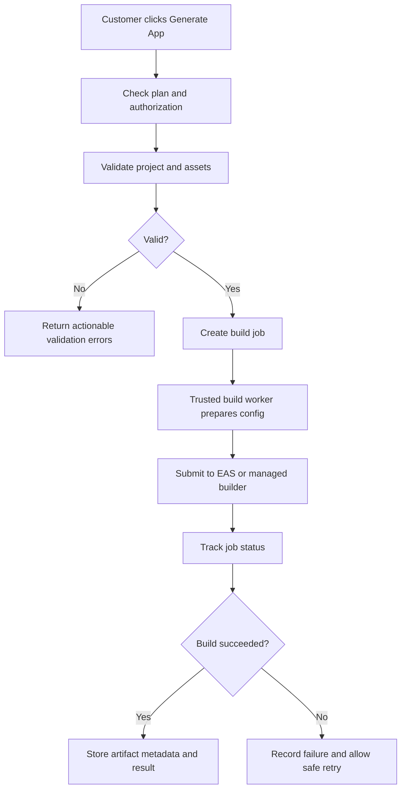

# Template-Driven SaaS Platform for Building Websites and Mobile Apps

> **Project status:** Planning / pre-MVP  
> **Working concept:** A self-service platform where businesses select a template, customize branding and content, publish a website, and later generate a separately branded Expo / React Native mobile application.  
> **Initial constraint:** Solo founder, keep early costs low, validate demand before buying more infrastructure or building advanced features.

---

## Table of Contents

1. [Executive Summary](#1-executive-summary)
2. [Product Vision and Value Proposition](#2-product-vision-and-value-proposition)
3. [Target Customers and Initial Niche](#3-target-customers-and-initial-niche)
4. [Product Principles](#4-product-principles)
5. [MVP Scope and Non-Goals](#5-mvp-scope-and-non-goals)
6. [User Journeys](#6-user-journeys)
7. [Recommended Technology Stack](#7-recommended-technology-stack)
8. [High-Level Architecture](#8-high-level-architecture)
9. [Template and Rendering Architecture](#9-template-and-rendering-architecture)
10. [Mobile App Generation Strategy](#10-mobile-app-generation-strategy)
11. [Monorepo Structure](#11-monorepo-structure)
12. [Initial Database Design](#12-initial-database-design)
13. [Authentication, Authorization, and Multi-Tenancy](#13-authentication-authorization-and-multi-tenancy)
14. [Website Publishing and Domains](#14-website-publishing-and-domains)
15. [Native Build Pipeline](#15-native-build-pipeline)
16. [Subscription and Revenue Model](#16-subscription-and-revenue-model)
17. [Low-Cost Infrastructure Strategy](#17-low-cost-infrastructure-strategy)
18. [AI-Assisted Development Workflow](#18-ai-assisted-development-workflow)
19. [Development Roadmap](#19-development-roadmap)
20. [Testing and Quality Strategy](#20-testing-and-quality-strategy)
21. [Security and Privacy Checklist](#21-security-and-privacy-checklist)
22. [Risks and Mitigations](#22-risks-and-mitigations)
23. [Metrics and Validation](#23-metrics-and-validation)
24. [Definition of Done](#24-definition-of-done)
25. [Immediate Next Steps](#25-immediate-next-steps)
26. [Questions to Validate Before Building](#26-questions-to-validate-before-building)
27. [Prompt for an Independent ChatGPT Review](#27-prompt-for-an-independent-chatgpt-review)
28. [External Resources to Verify](#28-external-resources-to-verify)

---

## 1. Executive Summary

The goal is to build a multi-tenant SaaS platform that enables small businesses to create and manage a branded online presence without having to build a website or mobile app from scratch.

A customer should be able to:

1. Register and create a workspace for their business.
2. Create a project and select a template for a specific business type.
3. Customize the logo, app/business name, colors, typography, page content, images, navigation, and supported features.
4. Preview the website and mobile layout.
5. Publish a website on a platform-provided subdomain and, later, connect a custom domain.
6. In a later phase, request a separately branded Expo / React Native Android or iOS build.
7. Manage their content and project settings from the same dashboard.

The platform owner earns revenue from customer subscriptions, higher usage limits, branded mobile app builds, and potentially paid onboarding or white-label services.

### Core strategic decision

**Start with a controlled template system and website publishing. Do not start by building a general-purpose no-code editor or fully automated app-store publishing system.**

The initial product should prove that a customer can choose a template, customize it without coding, and publish a useful website. Native app build automation comes after the website experience and demand are validated.

### Working assumptions

- The project is developed by one person.
- The founder is familiar with React, React Native, Expo, TypeScript, and JavaScript.
- The preferred initial backend is Supabase to reduce the amount of infrastructure to maintain.
- Next.js will be used for the SaaS dashboard and customer website rendering.
- Expo / React Native will be used for mobile app experiences and native builds.
- Google Antigravity Pro is available as the primary AI coding environment at the start.
- The first version should use free or low-cost services where appropriate, but reliability, security, and commercial-use terms take priority once customers depend on the service.
- Initial market focus is not final and should be validated with prospective customers.

---

## 2. Product Vision and Value Proposition

### Vision

Make it possible for a small business to create, customize, and manage a professional website and eventually a mobile app through one easy-to-use platform.

### Customer problem

Many small businesses need an online presence but may not have the budget, technical expertise, or time to manage a bespoke development project. Existing website builders may not provide the desired workflow for a branded native mobile app, while hiring separate web and mobile developers can be expensive.

### Proposed value proposition

> Choose a professionally designed business template, customize it with your brand and content, publish your website, and later generate a compatible branded mobile app from the same project configuration.

### Potential differentiators

- Website and mobile project managed in one dashboard.
- Niche-specific templates rather than generic blank pages.
- Shared business data and configuration across web and mobile experiences.
- Controlled customization that is easier to support than arbitrary user-generated code.
- A path from a simple hosted website to a separately branded mobile app.
- Affordable entry plan for small businesses.

These differentiators are hypotheses, not proven advantages. Customer interviews and paid pilots must validate them.

---

## 3. Target Customers and Initial Niche

Do not build templates for every industry at the beginning. Each industry has its own data, workflows, and expectations.

### Potential initial niches

| Niche | Likely initial features | Complexity | Notes |
|---|---|---:|---|
| Salons and local service businesses | Service list, staff profiles, business hours, contact, inquiries, booking request | Low–medium | Good MVP candidate if local businesses value a simple online presence |
| Fitness studios and coaches | Classes, schedules, trainer profiles, membership inquiry, booking | Medium | May need recurring schedules and member management later |
| Small retailers | Product catalog, categories, cart, checkout, orders | Medium–high | Payment, inventory, refunds, and orders expand scope considerably |
| Restaurants | Menu, opening hours, location, reservations or ordering | Medium–high | Online ordering and delivery logistics can become complex |

### Initial recommendation

Start with **one narrow customer segment**, such as salons or fitness studios, after speaking with 5–10 potential customers. The choice should depend on which group has a real problem, is easy to reach, and is willing to pay.

### Discovery questions for potential customers

- How do you currently share your services, pricing, opening hours, and contact details online?
- Do you already have a website? What frustrates you about it?
- Do your customers ask for an app, or is a website enough?
- Which task would an online platform need to solve to be worth paying for?
- Would you prefer a monthly subscription, a setup fee, or a combination?
- What would you expect to pay for a working website? For a separate Android/iOS app?
- Who would own and manage customer data, domain registration, app-store accounts, and payment accounts?

Do not treat positive feedback alone as validation. Look for specific commitments such as a pilot, a deposit, or willingness to pay for a defined plan.

---

## 4. Product Principles

1. **Validate before expanding.** Build the smallest complete workflow that a customer will pay for.
2. **Configuration over code generation.** Use trusted, version-controlled templates and validated project configuration rather than generating arbitrary source code for every user.
3. **Secure tenant isolation from day one.** Every customer-owned record must have a clear ownership path and tested access policies.
4. **Version the configuration.** Published sites must be recoverable when a customer or a deployment causes a problem.
5. **Separate draft and published states.** Editing must not unintentionally break the live site.
6. **Keep platform billing separate from customer business transactions.** Avoid becoming the custodian of every customer's sales revenue.
7. **Keep costs measurable.** Track hosting, database, storage, build, bandwidth, email/SMS, payment, and support costs.
8. **Make AI-generated changes reviewable.** Use small commits, automated checks, and code review even when the founder is the only developer.
9. **Design for growth without premature complexity.** Use a modular monorepo first; introduce separate services when a clear need appears.
10. **Check current vendor and app-store policies.** Pricing, free quotas, platform terms, and publication requirements change over time.

---

## 5. MVP Scope and Non-Goals

### MVP: must-have

- User registration, sign-in, and sign-out.
- Workspace creation and basic ownership.
- Project creation.
- Two templates within the chosen niche.
- Template configuration stored in Supabase/PostgreSQL.
- Basic editor for logo, images, colors, text, and section visibility.
- Website preview.
- Draft and published states.
- Website publishing on a provider/platform subdomain.
- Basic page title, meta description, and social sharing metadata.
- Project version history or a safe rollback mechanism.
- Secure multi-tenant data policies using Supabase RLS.
- Minimal administrative visibility into projects, publication status, and errors.
- Error reporting and basic usage/cost tracking.

### Next after MVP

- Custom domains and automated TLS setup.
- More template variants for the validated niche.
- Customer booking or lead capture workflow, if required by the niche.
- Preview mode for Expo/mobile layout.
- Automated Android builds for a selected branded project.
- Paid subscriptions and usage allowances.
- Build-job tracking and downloadable artifacts.

### Explicit non-goals for the first version

- A free-form drag-and-drop editor comparable to professional design tools.
- Every business niche at once.
- Customer-authored JavaScript execution.
- User-created plugins or arbitrary components.
- A full multi-vendor marketplace.
- Complex inventory, accounting, delivery, refunds, and payout systems.
- Automatic app-store approval or guaranteed publication.
- A separate backend/database deployment for every generated app.
- AI-generated production code for every customer project.
- Microservices unless scaling or operational requirements justify them.

---

## 6. User Journeys

### A. SaaS customer journey

1. Customer visits the marketing site.
2. Customer creates an account and verifies their email if required.
3. Customer creates a workspace and enters basic business details.
4. Customer creates a project.
5. Customer chooses a supported template.
6. The platform copies the template's default configuration into a new project version.
7. Customer edits text, images, theme, contact details, and supported sections.
8. Customer previews the draft.
9. Customer publishes the site.
10. Customer receives a platform subdomain and can share the URL.
11. Customer updates content in the dashboard; changes remain draft until republished, unless a setting is explicitly designed for safe immediate updates.
12. Customer upgrades when they need more projects, features, custom domains, or native app builds.

### B. Internal admin journey

1. Inspect project status and basic errors.
2. View build/publish job status.
3. Manage template availability and compatibility versions.
4. Review usage and billing state.
5. Help a customer recover a configuration version or troubleshoot publishing.

Administrative capabilities must be protected and audited. Do not provide a generic admin override that bypasses tenant safeguards without logging and access controls.

### C. Later branded mobile app journey

1. Customer chooses “Generate mobile app.”
2. The platform checks plan entitlement, required fields, assets, identifiers, and configuration validity.
3. The backend creates a build job and stores its status.
4. A trusted build worker prepares configuration based on a version-controlled Expo template.
5. EAS Build or an appropriate managed build environment produces the binary.
6. The platform records success/failure and provides a result or actionable error.
7. The customer handles distribution and required developer-account steps, or purchases a separately scoped publishing assistance service.

---

## 7. Recommended Technology Stack

Use the smallest stack that meets the product needs. Avoid introducing tools just because they are popular.

| Layer | Initial choice | Reason / notes |
|---|---|---|
| SaaS dashboard | Next.js + TypeScript | Dashboard, authenticated pages, server-side functions, editor UI |
| Website runtime | Next.js + React | Render published customer websites from validated project configuration |
| Mobile runtime | Expo + React Native + TypeScript | Mobile preview and future branded builds |
| Database | Supabase PostgreSQL | Managed relational database and SQL capabilities |
| Authentication | Supabase Auth | Managed authentication and session handling |
| File storage | Supabase Storage | Logos, banners, service images and other assets |
| Authorization | PostgreSQL RLS + server-side checks | Enforce tenant boundaries at the data layer as well as the application layer |
| Schema validation | Zod | Runtime validation for saved project configuration and API input |
| Forms | React Hook Form + Zod | Form state and validation in the dashboard |
| State management | React state initially; Zustand or Redux Toolkit when needed | Avoid unnecessary global state; use existing expertise when complexity warrants it |
| Styling | Tailwind CSS for dashboard | Consistent, fast dashboard UI development |
| Monorepo | npm/Yarn/pnpm workspaces; optionally Turborepo | Shared packages and coordinated builds |
| Version control | Git + GitHub | Change history, issue tracking, rollback, and collaboration readiness |
| Mobile builds | Expo EAS Build | Managed Expo/React Native build workflow; verify current plan quotas and pricing |
| SaaS billing | A supported Indian billing provider such as Razorpay, subject to eligibility and terms | Recurring subscription/payment handling; verify current requirements before integration |
| Error monitoring | Start with provider logs; add a suitable error monitoring service when needed | Do not overbuild observability before the first usable workflow |
| Email | Supabase Auth email defaults for early development; reliable transactional email service for production if required | Verify rate limits and production deliverability |

### Should Django REST Framework be included immediately?

Not by default. Supabase is enough for the initial authentication, relational database, file storage, and straightforward data operations.

Consider Django REST Framework later if there is a specific need for complex backend workflows, Python libraries, custom administrative systems, integrations, or a centralized orchestration API that is easier to maintain in Django. Adding a second backend too early increases deployment, authentication, testing, and operational complexity.

### Architecture boundary

The shared package should primarily contain types, validation schemas, and business rules. Do not force all visual UI components to be shared between React for web and React Native for mobile. Web and mobile may share configuration and data models while rendering different layouts.

---

## 8. High-Level Architecture

```text
                         BUSINESS OWNER
                               |
                               v
                     NEXT.JS SAAS DASHBOARD
                  Auth / Projects / Template Editor
                               |
                               v
                 VALIDATION + PROJECT SERVICE LAYER
                   /            |             \
                  v             v              v
             SUPABASE       ASSET STORAGE    BILLING
            Auth + SQL       Logos/images    Later phase
                  |
                  v
          VERSIONED PROJECT CONFIG
                  |
           +------+----------------+
           |                       |
           v                       v
  WEBSITE RENDERER          EXPO MOBILE RUNTIME
           |                       |
           v                       v
  HOSTED CUSTOMER SITE      NATIVE BUILD SERVICE
                                   |
                                   v
                           EAS / BUILD WORKER
                                   |
                                   v
                          ANDROID / iOS ARTIFACT
```

### Key design choices

- One SaaS control plane manages user accounts, workspaces, projects, templates, publishing, and billing.
- Projects are tenant-owned records in a shared database.
- Template definitions and rendering components are maintained in version-controlled code.
- Customer choices/content are stored as validated configuration and related domain data.
- Websites are rendered by a runtime that resolves a host/subdomain to a published project version.
- A separate build service handles native compilation later; the web request should not wait for a long build.
- Build credentials and privileged secrets exist only in trusted server-side environments.

---

## 9. Template and Rendering Architecture

### Recommended model: controlled configuration-driven templates

Do not create a completely separate codebase for every customer at the beginning. Maintain a set of trusted templates and render them from each customer's configuration.

A template should define:

- A stable template ID and version.
- Supported page types and section types.
- Default configuration.
- A schema for validating customizations.
- Feature capabilities and compatibility requirements.
- Web components and, when available, mobile equivalents.
- Migration logic if the configuration schema changes.

### Example configuration

This is a conceptual example only. Final schema design should be validated against the chosen niche and component registry.

```json
{
  "schemaVersion": 1,
  "template": {
    "id": "salon-v1",
    "version": 1
  },
  "business": {
    "name": "Sunrise Salon",
    "description": "Hair and beauty services",
    "phone": "+91-0000000000",
    "email": "hello@example.com"
  },
  "theme": {
    "primaryColor": "#7856D7",
    "backgroundColor": "#FFFFFF",
    "textColor": "#222222",
    "fontFamily": "Inter"
  },
  "branding": {
    "logoAssetId": "asset-logo-001",
    "iconAssetId": "asset-icon-001"
  },
  "navigation": ["Home", "Services", "Contact"],
  "features": {
    "serviceList": true,
    "bookingRequest": true,
    "contactForm": true
  },
  "sections": [
    { "type": "hero", "visible": true },
    { "type": "service-list", "visible": true },
    { "type": "testimonials", "visible": false },
    { "type": "contact-section", "visible": true }
  ]
}
```

Avoid putting secrets, service-role credentials, payment provider secret keys, or private data in the project configuration.

### Component registry

Example TypeScript union:

```ts
export type SectionType =
  | "hero"
  | "service-list"
  | "product-grid"
  | "testimonials"
  | "booking-form"
  | "contact-section";
```

A renderer maps a validated `SectionType` to an existing trusted component. The customer may configure supported properties; the customer must not be able to inject arbitrary executable code.

### Draft and published versions

Use versioned project configuration. The dashboard saves a draft version, and publishing points the project's published reference to a validated immutable version. Rollback should restore a previous published version without deleting history.

Possible fields include:

- `draft_version_id`
- `published_version_id`
- `published_at`
- `publication_status`

The final design may use a separate publication table or deployment history table if that is cleaner.

### Schema compatibility

A published project can outlive the current release of the renderer. Therefore:

- Store `schemaVersion` and template ID/version.
- Keep old template versions rendering for a reasonable compatibility window.
- Write explicit migrations for configuration changes.
- Test sample project configurations before deploying a renderer change.
- Never silently reinterpret a customer's saved configuration if it can alter the live site.

---

## 10. Mobile App Generation Strategy

There are two different mobile delivery models. They should not be confused.

### Model A: shared Expo app / remote configuration

One installed Expo app loads a project's content and supported configuration. This is useful for development preview and may be suitable for a single shared app product, but it does not automatically give every business its own app-store identity.

Advantages:

- Quick iteration on supported content and theme changes.
- Fewer native builds during early development.
- Useful for a mobile preview.

Limitations:

- All customers may effectively be using the same installed application identity.
- App name, icon, bundle/application ID, and native settings cannot generally be changed for an already-installed binary just by updating database configuration.
- Store distribution and platform policy implications need separate evaluation.

### Model B: separately branded native application

A build is produced for each customer or customer project using a trusted Expo template and customer-specific configuration.

The build may need:

- App display name.
- Unique iOS bundle identifier and Android application ID.
- App icon and splash assets.
- Environment/configuration values.
- Required entitlements and native plugins.
- Signing/build credentials.
- A supported runtime/template version.
- Customer-owned store accounts and distribution details, where applicable.

Changing native identity or native capabilities generally requires a new build. Compatible JavaScript/assets may sometimes be updated using Expo's update mechanisms, subject to runtime compatibility and platform policy.

### Recommended order

1. Build a mobile preview renderer that consumes the same validated configuration.
2. Ensure one branded Android test app can be generated repeatably.
3. Add an asynchronous job queue and status reporting.
4. Add plan entitlements and build quotas.
5. Add iOS builds after the Android workflow is reliable.
6. Add store submission assistance only after confirming current Apple/Google policies and the correct account ownership model.

### Build pipeline safeguards

- Never execute arbitrary customer-provided build scripts.
- Validate asset types and configuration before queuing a build.
- Use isolated or appropriately managed build infrastructure.
- Do not expose signing credentials or privileged environment variables.
- Rate-limit build requests and enforce plan limits.
- Store job status, timestamps, build identifiers, logs where appropriate, and artifact metadata.
- Provide actionable failure messages and allow safe retries.
- Track per-build costs and prevent unlimited build loops.

### Important app-store caveat

Generating an installable binary does not guarantee app-store approval. Near-identical or template-generated apps may face review or quality restrictions, and requirements change. Customers should own appropriate developer accounts and have a legitimate use case and differentiated business content. Check the latest store rules before selling automated publication as a feature.

---

## 11. Monorepo Structure

A starting structure could look like this:

```text
app-builder/
├── AGENTS.md
├── README.md
├── package.json
├── tsconfig.base.json
├── apps/
│   ├── dashboard/             # Next.js SaaS dashboard/editor
│   ├── website-runtime/       # Next.js published website renderer
│   └── mobile/                # Expo / React Native preview/runtime
├── packages/
│   ├── schemas/               # Zod configuration and API schemas
│   ├── types/                 # Shared TypeScript types
│   ├── template-registry/     # Template metadata and capabilities
│   ├── template-configs/      # Versioned defaults and migrations
│   ├── business-logic/        # Shared rules without UI dependencies
│   └── supabase/              # Generated DB types and safe helpers
├── supabase/
│   ├── migrations/
│   ├── seed.sql
│   └── tests/
├── workers/
│   └── build-service/         # Later: native build orchestration
├── docs/
│   ├── architecture.md
│   ├── database-design.md
│   ├── security.md
│   ├── template-system.md
│   └── roadmap.md
└── tests/
```

This is an intended structure, not a requirement to create every folder on day one. Start with the smallest working monorepo and add packages when code is genuinely shared.

### Monorepo rules

- Choose one package manager and commit its lockfile.
- Pin or deliberately manage important framework/tool versions.
- Keep secrets out of source control.
- Generate database types from Supabase when useful; avoid manually duplicating schema types indefinitely.
- Keep React DOM and React Native-specific UI implementations separate.
- Keep the root README focused on setup, commands, and the current project state. This strategic plan can live in `docs/roadmap.md` once the repository grows.

---

## 12. Initial Database Design

Use a shared PostgreSQL database with clear tenant ownership relationships. A separate Supabase project per customer would create unnecessary provisioning, cost, and maintenance work for the initial product.

### Core tables

| Table | Purpose | Initial priority |
|---|---|---:|
| `profiles` | User-specific profile information linked to authentication identity | Must-have |
| `workspaces` | Business/customer account and ownership boundary | Must-have |
| `workspace_members` | Workspace membership and roles | Must-have, even if initially only owner exists |
| `projects` | Website/mobile project metadata and state | Must-have |
| `templates` | Template ID, version, status, supported capabilities | Must-have |
| `project_versions` | Versioned project configuration and publication history | Must-have |
| `assets` | Metadata for uploaded assets and their ownership | Must-have |
| `domains` | Platform subdomain and customer custom-domain mappings | Needed for publishing |
| `subscriptions` | Plan and payment-provider state | Needed before paid launch |
| `usage_events` or counters | Publish/build usage and plan enforcement | Needed before paid usage limits |
| `build_jobs` | Request, status, provider build ID, outputs, timestamps | Later mobile phase |
| `audit_logs` | Sensitive administrative/security events | Add before broader production use |

Potential later tables depend on the first niche:

- `services`, `staff`, `appointments` for salons/service businesses.
- `classes`, `trainers`, `memberships` for fitness businesses.
- `products`, `orders`, `order_items`, `inventory` for commerce.

Do not build every vertical's data model in advance.

### Example relationship diagram



### Design recommendations

- Use UUID primary keys unless there is a specific reason not to.
- Use foreign keys and appropriate `ON DELETE` behavior deliberately.
- Add `created_at` and `updated_at` consistently.
- Store user identity in the trusted authentication identity, not in a user-editable field.
- Use a `workspace_id` on tenant-owned records where it improves clear enforcement and query design.
- For JSONB configuration, validate with Zod in trusted server-side code and maintain a schema version.
- Avoid storing public asset URLs as the only source of truth if asset metadata and access control matter; associate assets with asset records/IDs.
- Keep payment-provider identifiers and subscription state server-controlled.
- Add indexes for ownership filters and frequently queried fields after validating actual query patterns.
- Use migrations as the source of truth for schema evolution.

---

## 13. Authentication, Authorization, and Multi-Tenancy

Security boundaries must be established before real customer data is stored.

### Suggested roles

- **Owner:** manages the workspace, billing, members, projects, and publishing.
- **Editor:** edits project content and may publish if granted permission.
- **Viewer:** can preview and inspect but cannot change project data.
- **Platform administrator:** a separate, tightly controlled operational role; not a normal customer role.

### Essential rules

1. Every customer project is associated with a workspace.
2. Membership is the basis for authorizing access to workspace data.
3. Configure RLS policies for every exposed tenant-owned table.
4. Do not rely only on hiding UI buttons; enforce authorization in the database and trusted server-side handlers.
5. Protect storage objects through policies or a secure server-mediated access approach appropriate for the asset.
6. Never expose a Supabase service-role/secret key in browser code, the mobile bundle, or public environment variables.
7. Keep payment webhooks and privileged build/publish operations server-side.
8. Validate all IDs and input data; possession of a project ID is not proof of authorization.
9. Add rate limiting to authentication-adjacent, form, publishing, and build operations as needed.
10. Audit sensitive administrative actions and keep production secrets out of logs.

### Required tenant-isolation tests

Create two test users and two workspaces. Verify that:

- User A cannot read User B's project by changing the project ID.
- User A cannot update or delete User B's project.
- User A cannot read or replace User B's assets.
- User A cannot create a version attached to User B's project.
- A non-owner cannot manage workspace membership or billing.
- Anonymous users can access only intentionally published public data.
- Server-side jobs do not trust client-supplied workspace IDs without independently checking permissions.

Test policies using realistic authenticated roles, not only with an administrator/service-role connection that bypasses ordinary RLS checks.

---

## 14. Website Publishing and Domains

### Initial publishing model

1. Each project has a draft configuration version.
2. The user previews the draft.
3. On publish, the platform validates all configuration and referenced assets.
4. A published version is marked immutable for rollback purposes.
5. A hostname/subdomain resolves to the project's published version.
6. The website runtime renders that version.
7. The dashboard displays publishing status and any errors.

### Platform subdomains

Start with a platform-controlled hostname, for example:

`https://sunrise-salon.example-platform-domain.com`

The example is illustrative; choose a real domain after validating the product.

Hostname resolution needs to be safe. Normalize hostnames, verify domain ownership where required, prevent one project from claiming another project's hostname, and avoid using an arbitrary incoming host to query private project data.

### Custom domains later

Custom-domain support typically involves:

- Domain input and normalization.
- Domain ownership verification through DNS or the hosting provider's supported process.
- Correct DNS instructions.
- TLS/HTTPS provisioning and renewal.
- Host-to-project mapping.
- Handling duplicate domains and removals safely.
- Clear status and troubleshooting information.

Do not add custom domains before the basic platform-hosted publishing flow works reliably.

### SEO and production quality

- Unique title and meta description.
- Correct canonical URL when relevant.
- Open Graph/social share metadata.
- Sitemap and robots rules as appropriate.
- Mobile-responsive output and accessibility checks.
- Sensible 404 and unpublished-project behavior.
- No private draft data in public responses.

---

## 15. Native Build Pipeline

Native builds are a separate system from website publishing. Keep them out of the critical path for basic website publishing.

### Proposed later workflow



### Build-job fields to consider

- `id`
- `project_id`
- `project_version_id`
- `requested_by`
- `platform` (Android/iOS)
- `status` (queued/running/succeeded/failed/cancelled)
- `provider_build_id`
- `template_version`
- `created_at`, `started_at`, `completed_at`
- `error_code` and safe diagnostic summary
- `artifact_location` or provider artifact metadata
- usage/billing references

### Operational considerations

- Build creation must be authorized and entitlement-checked server-side.
- Use idempotency or duplicate-request protection.
- Add queueing and concurrency limits.
- Retry only where safe and do not retry permanent validation failures indefinitely.
- Separate user-facing errors from sensitive build logs.
- Retain build outputs only as long as the product and terms require.
- Account for costs, build-provider limits, and credential rotation.

---

## 16. Subscription and Revenue Model

Two kinds of revenue/payment must remain separate.

### A. Platform subscription revenue

Customers pay the platform to use the builder.

Possible plan structure to test with real users:

| Plan | Indicative early hypothesis | Possible entitlement |
|---|---:|---|
| Free | ₹0 | One project, preview, limited publishing, platform branding, limited usage |
| Starter | ₹999/month as a test price | One published site, custom branding, basic forms, defined usage allowance |
| Business | ₹2,499/month as a test price | More features/usage, custom domain, additional projects or team capabilities |
| White-label / Pro | Quote or higher plan | Native build credits, branded mobile build, agency functionality, optional onboarding/support |

These prices are hypotheses, not researched final prices. Validate willingness to pay, compare competitors, calculate costs, and decide whether Indian-market pricing is appropriate before launch. Taxes, payment-provider fees, currency, and local legal obligations also need consideration.

### Suggested entitlements to enforce

- Number of workspaces/projects.
- Number of published sites.
- Custom-domain availability.
- Available template/features.
- Monthly build credits.
- Storage and bandwidth limits.
- Team member limits.
- Support level.
- White-label branding controls.

Enforce paid entitlements on the server, not only through front-end conditions.

### B. Customer business revenue

Customers may make money from their businesses through bookings, leads, memberships, or product/service sales. These transactions are separate from the subscription paid to the platform.

Avoid collecting all customer sales into the platform's account and building a payout system in the MVP. Prefer a model where each customer owns or connects their own appropriate merchant account, subject to provider support and applicable requirements.

### Billing implementation principles

- Start with one provider that supports your business and target market.
- Use server-side checkout/subscription creation.
- Validate webhook signatures and make webhook processing idempotent.
- Keep subscription entitlement state server-controlled.
- Handle failed payments, cancellations, downgrades, and grace periods explicitly.
- Never store raw payment card details yourself.
- Keep a local record of provider IDs and status transitions for troubleshooting.
- Review consumer, tax, privacy, and recurring-payment obligations with qualified resources when needed.

---

## 17. Low-Cost Infrastructure Strategy

The first goal is to keep costs low during development, not to guarantee that a production SaaS can operate indefinitely for free.

### Initial development setup

- VS Code or the selected AI coding environment.
- Git and a private GitHub repository.
- Supabase Free for the development database/auth/storage, subject to current terms and quotas.
- Expo tooling and EAS free allowance for limited prototype builds, subject to current plan constraints.
- A free development URL before purchasing a custom platform domain.
- Local sample data and seed scripts for reproducible development.

### Before accepting paying customers

Check that each vendor plan permits the intended commercial use. Review free-tier quotas, sleep/pausing rules, build limits, egress, backups, support, and overage behavior. Do not assume today's allowance will remain the same.

Production readiness may require:

- Paid or otherwise suitable commercial hosting.
- Automated database backups and a tested restoration process.
- Error monitoring and uptime checks.
- Domain and TLS management.
- A transactional email provider if required for dependable authentication/onboarding.
- Build credits and a queueing strategy.
- Security incident and customer-support procedures.

### Measure costs by customer

Track at least:

- Web hosting/compute.
- Database size and query load.
- Storage and image bandwidth.
- Egress/network traffic.
- Native build usage.
- Email/SMS and other integrations.
- Payment provider fees.
- Support/onboarding time.

Do not offer unlimited mobile builds on a low-price plan before you understand actual costs. Set quotas and add paid build credits if appropriate.

### Cost-driven upgrade triggers

Upgrade or redesign when:

- Free-tier restrictions affect uptime or commercial terms.
- Important customer data needs reliable backups and recovery.
- Builds regularly hit quota or queue limits.
- Response times degrade after query/index optimization.
- Custom-domain or production security requirements cannot be met.
- Support load requires better monitoring and automation.

---

## 18. AI-Assisted Development Workflow

### Primary development agent

Use the existing Google Antigravity Pro plan as the primary coding environment initially. Do not purchase Cursor and Claude Code at the same time just to compare them. Add another tool only if a concrete limitation appears, such as repeated difficulty with large refactors or a strong preference for a different editing workflow.

AI tools and plans change frequently. Reassess capability, quota, price, privacy terms, and workflow fit before adding another paid subscription.

### Use an agent in controlled steps

For every feature:

1. State the user problem and acceptance criteria.
2. Ask the agent to inspect the repository and summarize relevant existing code.
3. Ask for a small implementation plan and files likely to change.
4. Review the plan, especially its data model and security impact.
5. Implement only the agreed scope.
6. Run type checks, lint, tests, and relevant build commands.
7. Ask the agent to report the exact checks run and any failures.
8. Review the code diff yourself.
9. Test the actual user workflow in browser/device/emulator as appropriate.
10. Commit the working result and update relevant documentation.

Do not ask the agent to build the entire SaaS in one large prompt. Work in small vertical slices that can be demonstrated and tested.

### Repository instructions

Create an `AGENTS.md` file at the repository root. Example starter rules:

```markdown
# Development Rules

- Use TypeScript with strict type checking.
- Read the relevant architecture document before proposing structural changes.
- Do not add dependencies without explaining the need and alternatives.
- Use database migrations for all schema changes.
- Validate API inputs and persisted template configurations using shared schemas.
- Enforce tenant authorization on the server and in Supabase RLS policies.
- Never expose service-role keys, signing credentials, or payment secrets to clients.
- Do not run or execute arbitrary customer-provided code.
- Add tests for authorization, configuration validation, and publishing behavior.
- Run relevant type checks, lint, and tests after changes; report exact results.
- Do not silently change public configuration schemas or existing template behavior.
- Keep changes scoped to the requested milestone.
- Explain risky/destructive commands before executing them.
- Update documentation when architecture or setup commands change.
```

Adapt the exact instruction file format to the capabilities supported by the selected coding environment.

### Git discipline

- Keep main branch stable.
- Use a feature branch for a meaningful feature or risky refactor.
- Commit after each working milestone.
- Review `git diff` before committing.
- Never commit `.env` files, keys, signing credentials, customer data, or build artifacts that contain secrets.
- Use a safe backup/commit before allowing the agent to perform a significant structural refactor.

### Safe parallelism

Do not let several agents independently rewrite shared architecture files at once. If parallel agents are used later, assign separate bounded tasks, such as tests, documentation, or an isolated component. Keep schema and shared-type ownership clear.

---

## 19. Development Roadmap

The following is a planning sequence for a solo developer, not a delivery guarantee. The schedule will depend on available hours, chosen niche, customer feedback, and the complexity of publishing/build infrastructure.

### Phase 0 — Product discovery and technical proof

**Suggested window:** Before the main build

Tasks:

- Pick a candidate business niche.
- Interview 5–10 potential customers.
- Review relevant competing tools and pricing.
- Sketch the dashboard, template editor, published website, and mobile experience.
- Write a short product requirements document.
- Validate that the desired hosting approach can support a multi-tenant Next.js runtime.
- Decide the initial domain/subdomain approach.

Deliverable:

- A specific customer problem, an initial feature set, and one template concept supported by actual feedback.

Exit criteria:

- At least a few prospects agree to review a prototype; ideally, one or more commit to a pilot or paid test.

### Phase 1 — Repository and platform foundation

Tasks:

- Create the monorepo and choose the package manager.
- Add the root README and repository agent instructions.
- Set up linting, formatting, TypeScript strictness, and basic test commands.
- Configure development and production environment variables safely.
- Create a Supabase project for development.
- Add migration-based schema setup.
- Implement auth, profiles, workspaces, membership, and project creation.
- Implement initial RLS policies and tenant-isolation tests.

Deliverable:

- A logged-in user can create a workspace and project, with data access enforced by ownership and membership.

### Phase 2 — First configuration-driven template

Tasks:

- Create the template registry.
- Define the first template configuration schema with Zod.
- Store template defaults and metadata in version-controlled code.
- Build the first web renderer.
- Seed sample project configuration.
- Render the initial template without a visual editor first.
- Add tests for valid and invalid configuration.

Deliverable:

- One project renders a functional website from saved structured configuration.

### Phase 3 — Visual editor and draft/published state

Tasks:

- Add editor layout: structure panel, preview area, properties panel.
- Edit business name, headings, description, colors, and images.
- Toggle supported sections and configure navigation.
- Upload assets securely.
- Save draft configuration.
- Add validation errors and save status.
- Add project versions and published version pointer.
- Test rollback.

Deliverable:

- A non-technical user can customize and preview a template without modifying code.

### Phase 4 — Website publishing

Tasks:

- Implement platform-hosted subdomains.
- Resolve the request hostname to an authorized published project.
- Render only the published version publicly.
- Add 404/unpublished states and error reporting.
- Add basic SEO metadata and responsive checks.
- Add publish history and rollback.
- Verify commercial hosting terms and costs.
- Add an initial backup/recovery plan before real paying customers depend on it.

Deliverable:

- A customer can publish and share a live branded website.

### Phase 5 — Pilot customers and paid launch readiness

Tasks:

- Onboard a few pilot customers manually.
- Observe their setup process and areas of confusion.
- Fix major template/editor issues.
- Track usage and infrastructure cost.
- Add plan entitlements and subscription integration when ready.
- Add terms, privacy policy, support contact, and account/data deletion procedures as appropriate.
- Confirm relevant legal, tax, privacy, and payment-provider obligations.

Deliverable:

- Real customer usage and evidence of willingness to pay.

### Phase 6 — Expo/mobile preview

Tasks:

- Implement the mobile template with corresponding component semantics.
- Reuse shared types and Zod schemas where practical.
- Fetch only data/configuration that the user is authorized to access.
- Support loading/error/empty states and offline behavior where appropriate.
- Test Android layout and navigation.
- Confirm what must remain native versus remotely configurable.

Deliverable:

- A mobile preview uses the same project configuration but a mobile-specific UI implementation.

### Phase 7 — Branded Android build pipeline

Tasks:

- Create one reusable Expo build template.
- Define required app metadata and validation rules.
- Enforce build plan entitlement and user authorization server-side.
- Add a build-job model and asynchronous status tracking.
- Integrate EAS Build or a suitable build service.
- Generate a single branded Android test build end-to-end.
- Protect credentials and limit build concurrency.
- Track build usage and cost.

Deliverable:

- One eligible project can reliably request and receive an Android artifact with useful error reporting.

### Phase 8 — Expand based on demand

Possible additions:

- Custom domains.
- Additional templates and verticals.
- iOS builds.
- Agency/white-label workspace features.
- Team roles and collaboration.
- Booking, payments, commerce, or integrations driven by customer demand.
- Template marketplace or template authoring tools.
- Better analytics and onboarding.

Do not proceed with every item automatically. Prioritize based on customer demand, business value, security burden, and operating cost.

---

## 20. Testing and Quality Strategy

### Unit tests

- Configuration schemas accept valid inputs and reject unsupported fields/types.
- Template registry resolves correct template/version.
- Feature entitlement rules return expected outcomes.
- Domain normalization and project configuration transformations behave correctly.
- Version migration functions preserve required values.

### Integration tests

- User can create a workspace and project.
- Unauthorized users cannot read or modify tenant-owned rows.
- Asset policies prevent cross-tenant access.
- Draft saving does not change the public site before publishing.
- Publishing updates the published version pointer safely.
- Rollback restores a previous version.
- Subscription webhook replay does not duplicate entitlement changes.
- Build requests cannot bypass usage and authorization checks.

### End-to-end browser tests

- Sign up / sign in.
- Create workspace and project.
- Select template.
- Edit the logo, title, and theme.
- Preview changes.
- Publish the website.
- Open the public URL in a clean browser context.
- Confirm a draft is not exposed publicly.

### Mobile tests

- Test on a real Android device where possible.
- Test navigation and loading/error/empty states.
- Test small and large screens.
- Verify project identity and configuration are resolved correctly.
- Test a complete development build before selling native build output.

### Required automation

Before merging a meaningful change, run the relevant subset of:

- TypeScript type checks.
- Linting and formatting checks.
- Unit tests.
- Integration tests.
- Build checks.
- End-to-end tests where practical.

A test suite does not replace a human review of security-sensitive flows.

---

## 21. Security and Privacy Checklist

This list is a baseline, not a substitute for a professional security review.

### Identity and access

- [ ] Supabase RLS enabled on exposed tenant-owned tables.
- [ ] Policies reviewed for both read and write operations.
- [ ] Workspace role checks are enforced server-side.
- [ ] Admin/operational access is restricted and auditable.
- [ ] Tenant isolation tested with multiple real test accounts.

### Secrets and integrations

- [ ] Service-role and provider secret keys exist only in trusted server environments.
- [ ] No secrets in client bundles or public environment variables.
- [ ] Webhook signatures verified.
- [ ] Secrets are not committed to Git or printed in logs.
- [ ] Native signing/build credentials are appropriately restricted.

### User input and files

- [ ] Project configuration validated at the server boundary.
- [ ] No arbitrary customer JavaScript or build script execution.
- [ ] Upload size/type constraints in place.
- [ ] Asset access matches workspace/project permissions.
- [ ] Forms are validated, rate-limited when exposed publicly, and protected from spam where needed.
- [ ] Output is escaped/handled safely to prevent XSS in web renderers.

### Operations

- [ ] Database backup and restore process documented and tested before relying on production data.
- [ ] Error reporting does not leak secrets or sensitive customer data.
- [ ] Build and publish actions are authorized and rate-limited.
- [ ] Account deletion and data-retention behavior are documented.
- [ ] Dependency updates and vulnerabilities are monitored.
- [ ] Privacy policy, terms, and customer support details are prepared for public launch.

---

## 22. Risks and Mitigations

| Risk | Why it matters | Mitigation |
|---|---|---|
| Building too much before validation | Months may be spent on features customers do not need | Interview prospects, launch one niche, and seek paid pilots early |
| Template explosion | Every new niche increases test and support burden | Start with two templates in one vertical; reuse data structures where appropriate |
| Cross-tenant data exposure | Could expose customer data and damage trust | RLS, server authorization, storage policies, and adversarial tests with multiple users |
| Free plan restrictions | Service may pause, impose quotas, or prohibit commercial usage | Verify current terms before production; upgrade only when needed |
| Native build cost and failures | Builds are slower and have provider limits | Queue jobs, cap plan usage, validate early, track cost and error rates |
| App-store rejection | A successful build does not imply approval | Review current policies and avoid promising approval or automatic publication |
| Dynamic configuration compatibility | Renderer changes may break old projects | Version configs/templates and test migrations and published fixtures |
| AI-generated insecure code | Fast implementation may hide authorization flaws | Require tests, review diffs, validate RLS, and keep privileged operations server-side |
| One-person operational overload | Support and infrastructure can overwhelm feature development | Narrow scope, use managed services, define support levels, and automate common issues |
| Underpricing | Usage and support costs may exceed revenue | Measure cost per workspace/project/build before offering unlimited usage |
| Platform dependency | Pricing or APIs may change | Keep boundaries modular, document assumptions, and avoid needless coupling |

---

## 23. Metrics and Validation

Measure whether the platform creates customer value before measuring vanity metrics like the number of templates or lines of code.

### Product metrics

- Number of people who sign up.
- Percentage who create a project.
- Percentage who select a template.
- Percentage who finish basic customization.
- Percentage who publish a website.
- Time from signup to first published site.
- Number of published sites still receiving activity after 30 days.
- Number of customers who ask to add a custom domain or mobile app.

### Business metrics

- Pilot-to-paid conversion rate.
- Monthly recurring revenue (MRR).
- Customer acquisition cost when paid acquisition begins.
- Monthly churn and reasons for cancellation.
- Revenue and gross margin per customer/plan.
- Support time per customer.
- Upgrade rate from website-only to native build plans.

### Reliability and cost metrics

- Site availability and response latency.
- Publish failure rate.
- Build success rate and average build completion time.
- Cost per active workspace.
- Cost per published site.
- Cost per native build.
- Database/storage/egress usage.
- Time to recover a broken publication or restore data.

### Early validation goals

Possible initial learning targets, not promises:

- Interview at least 5–10 target customers.
- Test the first prototype with 3–5 pilot users.
- Learn whether at least one customer will pay for the exact initial offer.
- Observe whether users can publish without founder intervention.
- Know the approximate monthly cost of serving one active customer.

---

## 24. Definition of Done

### A feature is done when

- Requirements and acceptance criteria are met.
- Loading, empty, success, and error states are handled where relevant.
- Input is validated at trusted boundaries.
- Authorization is implemented where data or actions are protected.
- Relevant automated tests pass.
- Type checks and lint checks pass or existing failures are documented.
- The user flow has been exercised manually or with an end-to-end test.
- The code diff has been reviewed.
- No secrets are exposed.
- Documentation and environment setup are updated where necessary.
- A Git commit exists for the working milestone.

### MVP is ready for a controlled pilot when

- A user can sign up and create a project.
- At least one complete template can be customized.
- A published website is stable and shareable.
- Draft content is not accidentally exposed.
- Tenant-isolation tests pass.
- Critical configuration can be rolled back.
- Error and publishing status are visible to the operator.
- Backup/recovery expectations are clear.
- A real pilot customer can use the service without continuous developer intervention.

### Native generation is ready for a paid beta when

- The build pipeline succeeds repeatedly for a supported test configuration.
- Authorization, quotas, duplicate requests, failure, and retry paths are tested.
- Credentials are protected.
- Build artifacts and status are tracked.
- Customer ownership and store-distribution expectations are documented.
- Build cost and support overhead are known well enough to set a quota and price.

---

## 25. Immediate Next Steps

Perform these in order rather than starting all workstreams at once.

1. **Choose a candidate niche.** Use customer conversations, not personal preference alone.
2. **Write a one-page product requirements document.** Define the target customer, core problem, first template, and what “published” means.
3. **Interview 5–10 potential users.** Confirm the need for a website and determine whether a branded native app is truly needed initially.
4. **Sketch the initial interface.** Include dashboard, template selector, editor, preview, publishing status, and settings.
5. **Create the repository and instructions.** Add `AGENTS.md`, basic quality checks, and architecture notes.
6. **Create the Supabase schema and RLS tests.** Do this before adding customer content.
7. **Build one configuration-driven template.** Make it render from stored data before building the full editor.
8. **Implement customization and publishing.** Complete the smallest end-to-end customer workflow.
9. **Run a pilot.** Observe the customer using it and prioritize issues based on evidence.
10. **Only then design the native build service and paid mobile plan.**

### Suggested first milestone

> A user can sign in, create a project, choose one template, customize its business name and primary color, save the configuration, preview the result, and publish a working website on a platform subdomain.

This is the first end-to-end proof of the product. It is a better initial target than trying to implement subscriptions, custom domains, mobile build generation, and app-store submission at the same time.

---

## 26. Questions to Validate Before Building

These questions should be resolved through research and small experiments, not by adding speculative features.

### Product and market

- Which business niche should launch first?
- Is the core buyer a small business owner, freelance developer, agency, or reseller?
- Is the initial product primarily a website builder, or do customers truly need separate mobile apps?
- What is the smallest outcome the customer is willing to pay for?
- Which competitor or current manual workflow will customers replace?

### Template and editing model

- Are fixed section settings enough, or is drag-and-drop genuinely necessary?
- Should customers edit multiple pages in the first release?
- Which settings should be allowed per template?
- How will old template versions remain compatible?
- Are the web and native app expected to look identical, or optimized for each platform?

### Hosting and operations

- Which hosting setup is commercially permitted and supports the required Next.js routing model?
- How will hostnames map to published projects?
- When should database backups become mandatory?
- How will rate limits, abuse reports, and compromised accounts be handled?
- What is the expected cost per active customer and per native build?

### Mobile publishing

- Does each customer actually need a separate app-store listing?
- Who owns the Apple/Google developer accounts?
- Who maintains store metadata, privacy disclosures, screenshots, and app updates?
- Which customers are appropriate for a white-label branded build?
- What app-store policies apply to the intended template-generated apps at launch time?

### Business model

- What do competitors charge for a similar outcome?
- Which plan boundary reflects meaningful value?
- Should custom domains be included in the starter plan or a higher plan?
- How many build credits can a plan afford?
- How much support will each customer need?
- What refund, cancellation, data-export, and deletion policies are required?

---

## 27. Prompt for an Independent ChatGPT Review

Copy the following prompt along with this README into another ChatGPT conversation to get an independent assessment.

```text
Act as a critical SaaS product strategist, senior full-stack architect, DevOps engineer, and security reviewer. I am a solo developer planning the SaaS platform described in the attached README.md.

My background: I am familiar with React, React Native, Expo, TypeScript, and JavaScript. I want to use AI coding agents, especially Google Antigravity Pro, to accelerate development. I prefer Supabase for the initial backend and want to start with free or low-cost resources, upgrade only when usage or customer demand justifies it, and validate the business before overbuilding.

Do not simply praise the plan. Challenge the assumptions and identify risks, missing requirements, and simpler alternatives. Browse current official documentation when facts about pricing, free-tier limits, hosting, Expo builds, payment providers, security, or app-store policies may have changed. Clearly distinguish verified facts from estimates and assumptions.

Please produce:

1. Executive assessment: is this product viable as scoped, and what is the riskiest assumption?
2. Recommended initial customer niche and validation strategy, including alternatives and why one is preferable.
3. A smaller MVP scope that one developer can realistically complete, with explicit features to remove or postpone.
4. A recommended architecture and stack, explaining whether Next.js + Expo + Supabase is sufficient and whether Django REST Framework should be deferred.
5. A review of the multi-tenant data model, RLS policies, asset access, authentication, and privileged server operations.
6. A review of configuration-driven templates versus per-customer source-code generation.
7. A realistic website publishing approach for multiple customer subdomains and later custom domains.
8. A feasibility and policy review of separately branded Expo apps and app-store distribution.
9. A phased implementation roadmap with dependencies, acceptance criteria, and test requirements—not just a feature list.
10. A lean business model, plan limits, key cost drivers, and which prices should be validated with customers.
11. An initial monthly cost estimate for development and for a small commercial pilot. Use current pricing sources where possible; call out usage assumptions and unknowns instead of inventing precise costs.
12. A security checklist and a list of production blockers that must be resolved before accepting paying customers.
13. A development workflow for using Antigravity Pro safely, including AGENTS.md guidelines, Git habits, tests, and how to scope agent tasks.
14. A prioritized backlog with Must / Should / Could / Won't categories.
15. The first ten implementation tasks, ordered by dependency and with measurable acceptance criteria.

Be direct and specific. Where there are competing approaches, compare trade-offs and recommend one. Do not assume that every feature in the README should be built. Do not recommend paid tools unless the benefit is clear and the cost is justified.
```

---

## 28. External Resources to Verify

Vendor features, pricing, quotas, and terms can change. Re-check current official documentation before committing architecture decisions or accepting paid customers.

- **Supabase documentation:** https://supabase.com/docs
- **Supabase pricing:** https://supabase.com/pricing
- **Supabase Row Level Security:** https://supabase.com/docs/guides/database/postgres/row-level-security
- **Supabase Storage access control:** https://supabase.com/docs/guides/storage/security/access-control
- **Expo documentation:** https://docs.expo.dev/
- **EAS Build:** https://docs.expo.dev/build/introduction/
- **Expo app configuration:** https://docs.expo.dev/workflow/configuration/
- **Expo Updates:** https://docs.expo.dev/eas-update/introduction/
- **Next.js documentation:** https://nextjs.org/docs
- **Next.js deployment:** https://nextjs.org/docs/app/getting-started/deploying
- **Vercel plans and terms:** https://vercel.com/pricing and https://vercel.com/legal/terms
- **Cloudflare Workers:** https://developers.cloudflare.com/workers/
- **Razorpay Subscriptions:** https://razorpay.com/docs/payments/subscriptions/
- **Stripe availability:** https://stripe.com/global
- **Google Play Console:** https://play.google.com/console/about/
- **Apple Developer Program:** https://developer.apple.com/programs/
- **Apple App Review Guidelines:** https://developer.apple.com/app-store/review/guidelines/
- **Google Play policies:** https://support.google.com/googleplay/android-developer/topic/9858052
- **Google Antigravity:** Check the current official product documentation and account plan details.
- **GitHub:** https://docs.github.com/

These are starting points, not a claim that every feature or plan described above is currently available in every region or account type.

---

## Final Recommendation

Build the project as a **configuration-driven website builder first**, focused on one customer niche. Use Next.js for the dashboard and published website runtime, Expo for the mobile runtime, and Supabase for authentication, database, and storage. Maintain templates and renderer code in Git; store each customer's validated configuration and content in the database.

Use Google Antigravity Pro as the main coding agent initially, but keep architecture decisions, Git history, tests, and security reviews under your control. Validate the core workflow with real users before investing in automated native builds, complex editor features, or additional paid services.

The near-term target is not a massive platform. It is one reliable customer journey:

**Sign up → choose template → customize → preview → publish → receive feedback → validate willingness to pay.**
